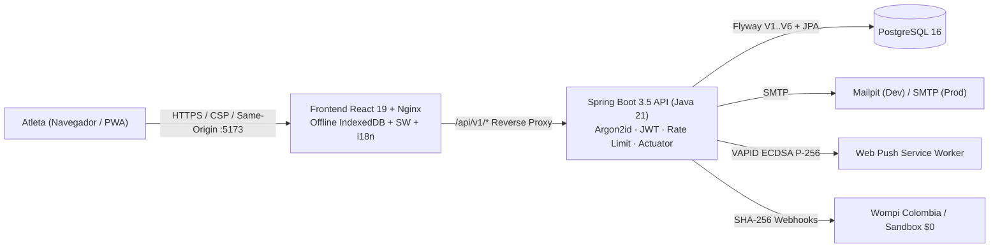

# 🏋️ CalisHome — SaaS Comercial de Calistenia en Casa (PWA + API Spring Boot)

Aplicación web progresiva (**PWA**) lista para lanzamiento comercial que planifica y guía rutinas de calistenia en casa con **100% cero material** (peso corporal, suelo y pared), sobrecarga progresiva adaptativa, modo offline, monetización Freemium y cumplimiento de privacidad **Ley 1581 / GDPR**.

---

## 🏗️ Arquitectura del Sistema



### Estructura del Monorepo

```text
calishome/
├── .github/workflows/
│   ├── ci.yml                  # Seguridad Trivy, Maven + Testcontainers, oxlint/Vitest/Vite
│   └── deploy.yml              # Build GHCR + Staging automático + Producción con aprobación manual
├── scripts/
│   ├── backup-postgres.sh      # pg_dump comprimido + cifrado AES-256 opcional + SHA-256
│   └── restore-postgres.sh     # Verificación de checksum + restauración + conteo de integridad
├── docs/
│   ├── decisiones.md           # Registro de decisiones arquitectónicas (ADR-001 .. ADR-016)
│   ├── amenazas-fase2.md       # Modelo de amenazas de autenticación
│   ├── auditoria-seguridad-fase5.md # Auditoría OWASP Top 10
│   └── runbook-produccion.md   # Runbook operativo, despliegue free-tier $0 y DRP
├── frontend/                   # React 19 + TS + Tailwind v4 + Vitest + Playwright E2E
├── backend/                    # Java 21 + Spring Boot 3.5 + Postgres + Flyway + Testcontainers
├── docker-compose.yml          # Stack completo con 1 comando (Postgres + Backend + Nginx + Mailpit)
└── CHANGELOG.md                # Historial de versiones (v1.1.0)
```

---

## 🚀 Levantar todo con un solo comando (Docker)

1. Copia la plantilla de variables de entorno:
   ```bash
   cp .env.example .env
   ```
2. Levanta PostgreSQL 16, Backend Spring Boot, Frontend Nginx y Mailpit:
   ```bash
   docker compose up -d --build
   ```
3. Accede a los servicios:
   - **Frontend PWA:** http://localhost:5173
   - **Planes & Sandbox Pro `$0`:** http://localhost:5173/plans
   - **Cuenta, Export JSON & Eliminación:** http://localhost:5173/account
   - **OpenAPI / Swagger UI (perfil `dev`):** http://localhost:8080/swagger-ui.html
   - **Backend Health:** http://localhost:8080/api/v1/health
   - **Mailpit SMTP Web UI (dev):** http://localhost:8026

### 🎯 Credenciales Demo para Portfolio (Modo Sandbox)
Cuando `APP_DEMO_SEED_ENABLED=true` y `BILLING_SANDBOX_ENABLED=true` (por defecto en Docker local, desactivado en `test` y `prod`), el sistema siembra automáticamente un atleta Pro con historial de 21 días y permite entrar en 1 clic desde **Iniciar Sesión → Entrar como Atleta Demo (Pro)**:
- **Email:** `demo@calishome.app`
- **Contraseña:** `DemoCalis2026!`

---

## 🔐 Endpoints Principales (`v1`)

| Dominio | Método y Ruta | Descripción | Auth |
|---|---|---|---|
| **Salud & Ops** | `GET /api/v1/health`, `/actuator/health`, `/actuator/metrics` | Estado API+DB y métricas | Público (`/health`) / JWT (`/metrics`) |
| **Auth** | `POST /api/v1/auth/register`, `verify-email`, `login`, `google`, `refresh`, `logout`, `forgot-password`, `reset-password` | Argon2id, JWT 15m, Refresh HttpOnly + CSRF, OIDC | Público / Cookie+CSRF |
| **Usuario & Privacidad** | `GET/PATCH /api/v1/users/me/profile`, `POST /me/import`, `GET /me/export`, `DELETE /me` | Diagnóstico, exportación JSON ARCO y borrado PII | Bearer JWT |
| **Rutinas & Catálogo** | `GET /api/v1/exercises`, `POST /api/v1/routines/preview`, `GET /routines/today`, `/weekly` | 24 ejercicios y motor determinista por objetivo/TZ | Público / Bearer JWT |
| **Entrenos & Analíticas** | `GET/POST /api/v1/workouts`, `GET /api/v1/workouts/analytics` | Registro, sobrecarga `-3..+3` y telemetría Pro | Bearer JWT (`PREMIUM` en `/analytics`) |
| **Web Push** | `GET /notifications/vapid-public-key`, `status`, `POST subscribe`, `test`, `DELETE unsubscribe` | Notificaciones VAPID + protección SSRF/IDOR | Público / Bearer JWT |
| **Monetización** | `GET /billing/plans`, `subscription`, `POST checkout`, `subscription/cancel`, `sandbox/complete`, `webhooks/wompi` | Planes Gratis/Pro, Sandbox `$0` y webhook SHA-256 | Público / Bearer JWT / Firma SHA-256 |

---

## 💻 Pruebas, Calidad y E2E

### Backend (Java 21 + Maven + Testcontainers)
```bash
cd backend
mvn -B verify
```

### Frontend Unit & Seguridad
```bash
cd frontend
npm run lint
npm audit --omit=dev --audit-level=high
npm test
npm run build
```

### Pruebas End-to-End (Playwright sobre Docker Compose + Mailpit)
```bash
cd frontend
npx playwright install chromium
npm run test:e2e
```

---

## 🚦 Checklist de Lanzamiento Comercial (`v1.0.0`)

- [x] Autenticación segura (Argon2id, JWT corto + Refresh rotativo HttpOnly, CSRF, lockout, Google OIDC, verificación email).
- [x] Motor de entrenamiento determinista en backend + racha justa según días programados + sobrecarga progresiva `-3..+3`.
- [x] Modo Offline-First (Service Worker + IndexedDB cache + cola diferida con sincronización automática al reconectar).
- [x] Accesibilidad WCAG 2.1 AA (Skip-to-Content, zoom móvil habilitado, atajos `Escape`, atributos ARIA) e i18n `ES/EN`.
- [x] Seguridad OWASP Top 10 (anti-SSRF, anti-IDOR, CSP/HSTS, rate limit global RFC 7807, `ClientIpResolver`, Trivy CI).
- [x] Monetización Freemium verificada con firma SHA-256 idempotente, período de gracia y límites por tier en servidor.
- [x] Cumplimiento Ley 1581 / GDPR (`GET /users/me/export`, `DELETE /users/me`, `/privacy`, `/terms` con Aviso Médico, `/account`).
- [x] Respaldos PostgreSQL automatizados con prueba real de restauración + Pipeline CI/CD (`staging` → `production`).

---

## 📚 Estado Final del Roadmap

- **Fase 1:** ✅ Monorepo, PostgreSQL + Flyway, `/api/v1/health`, RFC 7807, Docker Compose y CI.
- **Fase 2:** ✅ Modelo de datos, Argon2id, JWT + Refresh rotativo, verificación SMTP, recuperación, lockout, rate limit y Google OIDC.
- **Fase 3:** ✅ 24 ejercicios seeded, motor determinista por objetivo y TZ, racha justa, `React Router` + `TanStack Query` + `Zod` + importación idempotente.
- **Fase 4:** ✅ Web Push VAPID con limpieza `410 Gone`, scheduler TZ, Mailpit, PWA cache seguro y code splitting (`React.lazy`).
- **Fase 5:** ✅ Auditoría y endurecimiento OWASP Top 10 ([`docs/auditoria-seguridad-fase5.md`](docs/auditoria-seguridad-fase5.md)) + Trivy en CI.
- **Fase 6:** ✅ Monetización Freemium Wompi COP + Sandbox `$0`, webhooks SHA-256 idempotentes y analíticas Pro.
- **Fase 7:** ✅ Rediseño Obsidian & Kinetic Volt, IndexedDB offline sync queue, i18n `ES/EN`, WCAG 2.1 AA y Playwright E2E.
- **Fase 8:** ✅ Privacidad (`export`/`delete`), `/privacy`, `/terms`, `/account`, Demo Pro `$0`, `/actuator/metrics`, backup/restore PostgreSQL, CI/CD `staging`/`production` y [`docs/runbook-produccion.md`](docs/runbook-produccion.md).
